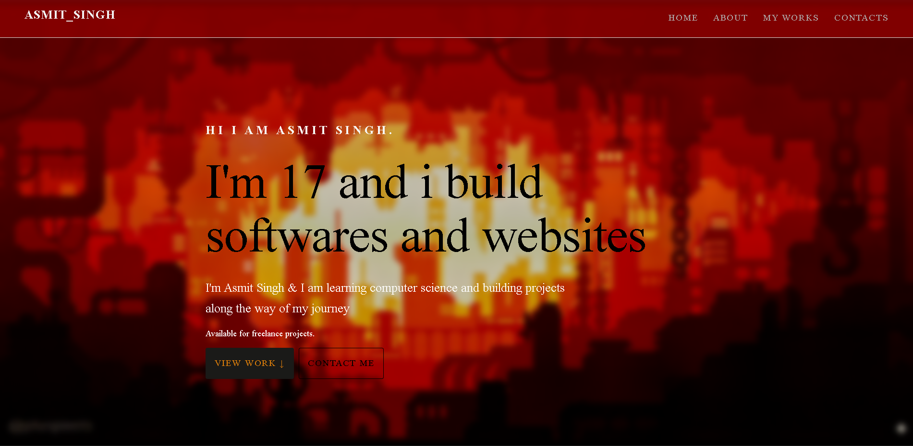

## Asmit's Builder Page
A personal portfolio website which describes me, the skills i have and the projects i made.

Live :- https://asmitsingh000.github.io/My_builder_page/




## What's on it ??
- **Hero** : Who am i, What am i building rn. 
- **About** : A short and simple info about me on : where i am from, what i am learning and what i want to do..
- **Skills** : Actually i know quite a lot of things but i am good at web development, game environment desgine, making mods in minecraft java.
- **Projects** : Things i have built, throughout the times till now..
- **Contacts** : From here you can contact me personally regarding my works.
- **Footer** : Nothing just reserved things (Ahhm i dont just looked good so i added :)) )

## Built with:
- **HTML 5**
- **CSS**

## How can you run it??
```
git clone https://github.com/asmitsingh000/My_builder_page.git
cd cafe-of-pixl
open index.html on you browser by clicking on it

```
